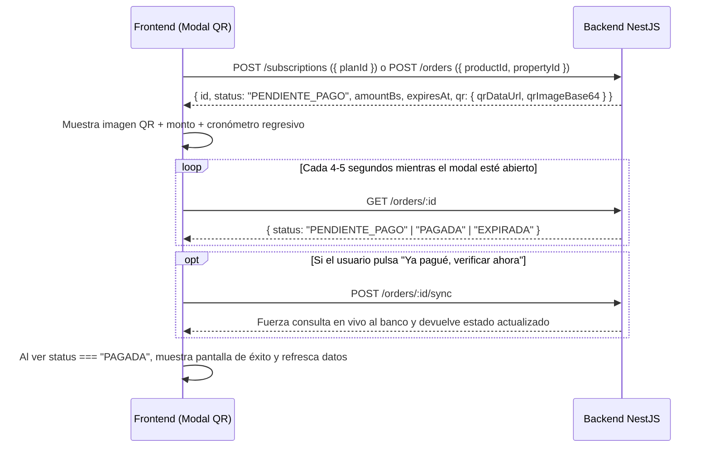

# Guía de Integración Frontend: Nuevo Sistema de Monetización, Pagos QR y Moderación (n8n)

Este documento describe **todos los cambios realizados en el backend (`api-inmobiliarias`)** y **todas las pantallas, flujos y componentes que debe implementar el Frontend** (Web y/o App Móvil) para salir a producción.

> **Documentación interactiva Swagger:** Al levantar el backend, todos los DTOs y endpoints están disponibles en `/api/docs`.

---

## 1. Cambios Clave respecto a la Versión Anterior (¡Importante!)

Antes de construir las vistas nuevas, el frontend debe adaptar estos cambios estructurales en los endpoints existentes:

### 1.1. Separación de `role`, `accountType` y `currentPlan`
Anteriormente `user.role` mezclaba permisos de sistema (`ADMIN`) con el plan comercial (`INMOBILIARIA`, `GRATIS`). Ahora están separados en **3 conceptos distintos**:

| Campo en `User` | Valores posibles | Uso en el Frontend |
| :--- | :--- | :--- |
| `role` | `'USER'` \| `'ADMIN'` \| `'REVISOR'` *(legacy soportados)* | **Permisos del sistema:** mostrar/ocultar el Panel de Administración o Bandeja de Moderación. |
| `accountType` | `'PARTICULAR'` \| `'AGENTE'` \| `'INMOBILIARIA'` | **Perfil comercial:** etiqueta visible en el perfil/anuncio del publicador. |
| `currentPlan` | Objeto con `code`: `'GRATIS'` \| `'PROPIETARIO'` \| `'AGENTE'` | **Límites y beneficios:** controla cuántos inmuebles activos, cuántas fotos por inmueble, si muestra logo y si desbloquea estadísticas. |

### 1.2. Cambios en Autenticación (`/auth/register` y `/auth/login`)
* **Login sigue siendo por teléfono (`phone`) + `password`.**
* `POST /auth/register` ahora acepta opcionalmente `accountType` (`'PARTICULAR' | 'AGENTE' | 'INMOBILIARIA'`) y `logoUrl` (`string`).
* Tanto `/auth/login` como `/auth/register` devuelven ahora el resumen del plan vigente dentro de `user.currentPlan`:
  ```json
  {
    "access_token": "eyJhbG...",
    "user": {
      "id": "uuid",
      "phone": "70000000",
      "email": "agente@correo.com",
      "name": "Inmobiliaria Sur",
      "role": "USER",
      "accountType": "INMOBILIARIA",
      "logoUrl": "https://cdn.../logo.png",
      "currentPlan": {
        "id": "uuid",
        "code": "AGENTE",
        "name": "Plan Agente / Inmobiliaria",
        "monthlyPriceBs": 149,
        "maxActiveProperties": null,
        "maxImagesPerProperty": 15,
        "includesStats": true,
        "includesLogo": true
      }
    }
  }
  ```
  *(Nota: `maxActiveProperties: null` significa **inmuebles ilimitados**).*

### 1.3. Cambios en el Modelo y Respuestas de `Property` (`/properties`)
1. **Estados del inmueble (`status`)**:
   * Ahora cada propiedad tiene `status`: `'ACTIVO' | 'PAUSADO' | 'INACTIVO'`.
   * `GET /properties` (público/mapa) devuelve **únicamente inmuebles con `status: 'ACTIVO'`**, ordenados poniendo **primero los destacados vigentes** (rotando su orden entre sí en cada carga para repartir visibilidad en la zona) y luego los normales más recientes.
   * Nuevo endpoint `GET /properties/me` (con Bearer Token) para que el propietario vea **todos** sus inmuebles (`ACTIVO`, `PAUSADO`, `INACTIVO`) junto con el estado de su última difusión y verificación.
2. **Nuevos campos al crear/editar (`POST /properties`, `PATCH /properties/:id`)**:
   * `zone?: string` (Barrio / Zona, ej. `"Sopocachi"`, `"Equipetrol"` — muy recomendado pedirlo en el formulario porque alimenta filtros y los posts de n8n).
   * `bedrooms?: number` (Cantidad de dormitorios, entero `>= 0`).
   * `PATCH /properties/:id` ahora acepta **actualización parcial** (solo los campos modificados).
   * **Regla crítica de seguridad en edición:** Si un inmueble ya tiene `isVerified: true` y el propietario modifica `city`, `zone`, `latitude` o `longitude`, **el backend suspende automáticamente el sello `isVerified: false`** hasta nueva revisión. El frontend debe mostrar un `confirm()` advirtiendo esto antes de guardar cambios de ubicación en un inmueble verificado.
3. **Nuevos campos calculados que llegan en `GET /properties` y `GET /properties/:id`**:
   ```json
   {
     "id": "uuid",
     "title": "Departamento soleado",
     "price": 25000,
     "currency": "USD",
     "listingType": "ANTICRETICO",
     "propertyType": "DEPARTAMENTO",
     "status": "ACTIVO",
     "city": "La Paz",
     "zone": "Sopocachi",
     "bedrooms": 2,
     "latitude": -16.5118,
     "longitude": -68.1274,
     "whatsapp": "59170000000",
     "images": ["https://..."],
     "featuredUntil": "2026-11-10T20:00:00.000Z",
     "isFeatured": true,
     "isVerified": true,
     "publisher": {
       "id": "uuid",
       "name": "Inmobiliaria Sur",
       "accountType": "INMOBILIARIA",
       "logoUrl": "https://cdn.../logo.png"
     },
     "verificationInfo": {
       "verifiedAt": "2026-10-20T14:00:00.000Z",
       "validUntil": "2027-04-20T14:00:00.000Z"
     }
   }
   ```
   > **Nota sobre `publisher.logoUrl`:** El backend ya aplica la regla comercial automáticamente: si el plan actual del usuario NO incluye logo (ej. venció su plan `AGENTE`), `publisher.logoUrl` vendrá en `null`. El frontend simplemente muestra el logo siempre que `publisher?.logoUrl` no sea `null`.

---

## 2. Nuevas Funciones y Pantallas que Debe Tener el Frontend

### 2.1. Mejoras en el Mapa Principal y Listado Público
1. **Pines Destacados (`property.isFeatured === true`)**:
   * Renderizar un marcador de color/tamaño destacado (ej. dorado/ámbar con ícono de estrella) y con `zIndexOffset` mayor en Leaflet para que siempre quede **por encima** de los pines estándar.
   * Mostrar badge `"Destacado"` en la tarjeta lateral o modal del inmueble.
2. **Sello `"Inmueble Verificado"` (`property.isVerified === true`)**:
   * Mostrar insignia de verificación (check azul/verde) en el pin, tarjeta resumen y vista de detalle.
   * En el detalle del inmueble, incluir un enlace/tooltip *"¿Qué significa Verificado?"* mostrando la fecha `verificationInfo.verifiedAt` y el texto legal aclaratorio.
3. **Marca / Logo de Agencia (`property.publisher?.logoUrl`)**:
   * Si `publisher.logoUrl` existe, mostrar el avatar/logo junto al nombre y tipo de cuenta (`AGENTE` / `INMOBILIARIA`) en la ficha del inmueble.
4. **Nuevos Filtros en el Mapa (`GET /properties`)**:
   * Query params disponibles: `city`, `zone`, `listingType`, `propertyType`, `minPrice`, `maxPrice`, `search`, `onlyFeatured=true`, `onlyVerified=true`, `page`, `limit`.
5. **Deep-Linking desde Redes Sociales + Captura de `utm_source`**:
   * Los enlaces que publica `n8n` en Facebook apuntan a:
     `https://tuapp.com/mapa?inmueble=<UUID>&utm_source=facebook&utm_medium=social&utm_campaign=difusion`
   * El frontend debe soportar tanto `?inmueble=<id>` como `?id=<id>` para abrir directamente la ficha del inmueble en el mapa, y guardar `utm_source` (ej. en `sessionStorage`) para enviarlo en los eventos de analítica.

---

### 2.2. Tracking de Eventos para Estadísticas (`POST /events`)
Debe dispararse **en segundo plano (fire-and-forget, sin bloquear la UI)** para **todos** los inmuebles, sin requerir que el visitante haya iniciado sesión:

* **Endpoint:** `POST /events` (Público)
* **Body:**
  ```json
  {
    "propertyId": "uuid-del-inmueble",
    "type": "VISTA_DETALLE",
    "source": "facebook"
  }
  ```
* **Valores válidos de `type`:**
  * `VISTA_PIN`: cuando el usuario toca un pin en el mapa (vista previa rápida).
  * `VISTA_DETALLE`: cuando abre la ficha completa del inmueble.
  * `CLIC_WHATSAPP`: cuando pulsa el botón de escribir por WhatsApp.
  * `CLIC_LLAMAR`: cuando pulsa llamar al teléfono.
  * `CLIC_CONTACTO`: clic genérico de ver datos de contacto / redes.
* **Valor de `source`:** Pasar el `utm_source` capturado de la URL (`"facebook"`, `"instagram"`, etc.); si entró directo, omitirlo o enviar `"directo"`.

---

### 2.3. Pantalla de Planes, Perfil y Cupo de Inmuebles (`/planes` y `/mi-cuenta`)
1. **Comparador de Planes (`GET /plans` — Público)**:
   * Muestra los planes activos (`GRATIS`, `PROPIETARIO`, `AGENTE`), su `monthlyPriceBs`, `maxActiveProperties` (`null` = Ilimitados), `maxImagesPerProperty`, `includesLogo` e `includesStats`.
2. **Resumen de Mi Plan (`GET /my-plan` — Requiere Auth)**:
   * Respuesta:
     ```json
     {
       "plan": { "id": "uuid", "code": "PROPIETARIO", "name": "Plan Propietario", "monthlyPriceBs": 49 },
       "subscription": {
         "id": "uuid",
         "status": "ACTIVA",
         "startDate": "2026-10-29T...",
         "endDate": "2026-11-29T..."
       },
       "limits": {
         "maxActiveProperties": 5,
         "maxImagesPerProperty": 8,
         "includesStats": false,
         "includesLogo": false
       },
       "usage": {
         "activePropertiesCount": 3,
         "pausedPropertiesCount": 1
       }
     }
     ```
   * Usar `limits.maxImagesPerProperty` en el formulario de publicar/editar inmueble para validar en cliente cuántas fotos puede subir el usuario según su plan actual.
   * Si `activePropertiesCount >= limits.maxActiveProperties`, mostrar banner *"Alcanzaste el límite de tu plan"* con CTA a **"Subir de Plan"**.
3. **Edición de Perfil y Logo (`PATCH /users/me`)**:
   * Permite actualizar `{ name, email, accountType, logoUrl }`. Si el usuario tiene `accountType` `AGENTE` o `INMOBILIARIA` pero su plan no incluye logo, mostrar nota: *"Tu logo se mostrará públicamente en tus anuncios al activar el Plan Agente"*.
4. **Campana de Notificaciones (`GET /users/notifications` y `PATCH /users/notifications/:id/read`)**:
   * El backend genera notificaciones automáticas cuando: se confirma un pago, vence una suscripción en 3 días, expira un plan y se pausan excedentes, se aprueba/rechaza una difusión en redes, o se aprueba/rechaza/suspende una verificación.

---

### 2.4. Componente Reutilizable: Modal de Pago con QR Dinámico (ApiBanco)

Tanto las **suscripciones** como los **4 productos por inmueble** usan exactamente la misma estructura de orden y pago QR:



* **Iniciar compra de Suscripción:** `POST /subscriptions` → Body: `{ "planId": "uuid" }`
* **Iniciar compra de Producto para un Inmueble:** `POST /orders` → Body: `{ "productId": "uuid", "propertyId": "uuid" }` *(Nota: el inmueble debe estar `ACTIVO`)*.
* **Cómo renderizar el QR:** La respuesta incluye `order.qr.qrDataUrl` (`"data:image/png;base64,iVBOR..."`), listo para poner directo en ``, más un botón **"Descargar imagen QR"** (muy útil en celulares para abrir la imagen desde la app bancaria).
* **Polling seguro:** Hacer `GET /orders/:id` cada 4 o 5 segundos. Este endpoint consulta únicamente nuestra base de datos (que se actualiza al instante por el Webhook de ApiBanco), por lo que es rápido y no consume rate-limit bancario.
* **Botón de respaldo *"Ya realicé el pago"*:** Llama a `POST /orders/:id/sync` (ponerle cooldown de ~10s en el botón). Fuerza al backend a sincronizar en directo con el banco si el webhook tardó.

---

### 2.5. Panel "Mis Inmuebles" (`/mis-inmuebles`) y Acciones por Inmueble

Consumir `GET /properties/me` y `GET /products` (catálogo de productos únicos: `DESTACADO_7`, `DESTACADO_15`, `DIFUSION_REDES`, `PAQUETE_DESTACADO_REDES`, `VERIFICACION`).

Para cada inmueble del usuario mostrar:

1. **Selector de Estado (`PATCH /properties/:id/status`)**:
   * Body: `{ "status": "ACTIVO" | "PAUSADO" | "INACTIVO" }`.
   * Cuando a un usuario se le vence su suscripción, sus inmuebles excedentes pasan a `PAUSADO` (no se pierden). Desde aquí puede pausar uno y activar otro libremente dentro del cupo de su plan.
2. **Acción "Destacar en el Mapa"**:
   * Permite elegir 7 días (`DESTACADO_7`), 15 días (`DESTACADO_15`) o el paquete con redes (`PAQUETE_DESTACADO_REDES`).
   * Si `isFeatured === true`, mostrar *"Destacado hasta `<featuredUntil>`"* y botón *"Extender días"* (el backend suma automáticamente los días nuevos a partir de la fecha de fin actual).
3. **Acción "Difundir en Facebook e Instagram"**:
   * Muestra el estado de `property.latestDiffusion`:
     * Sin difusión o `PUBLICADO` anterior → Botón *"Difundir en redes"* (abre Modal QR con `DIFUSION_REDES` o `PAQUETE_DESTACADO_REDES`).
     * `PENDIENTE` / `APROBADO` → Badge *"En revisión por el equipo para publicación"*.
     * `PUBLICADO` → Badge *"Publicado en redes"*.
     * `RECHAZADO` → Mostrar alerta con `latestDiffusion.rejectionReason`, permitir editar fotos/descripción del inmueble y pulsar botón **"Reenviar a revisión sin costo"** (`POST /diffusions/:diffusionId/resubmit`).
4. **Acción "Verificar Inmueble" (Sello Legal)**:
   * Muestra el estado de `property.latestVerification`:
     * Sin verificación → Botón *"Solicitar Verificación"* (abre Modal QR con `VERIFICACION`).
     * `DOCUMENTOS_PENDIENTES` o `RECHAZADO` → Mostrar botón **"Subir Documentos (Folio Real / CI)"** (si fue `RECHAZADO`, mostrar el motivo `rejectionReason`).
       * **Endpoint de subida:** `POST /verifications/:verificationId/documents`
       * **Formato:** `multipart/form-data` con campo `files` (hasta 10 archivos `PDF`, `JPG`, `PNG` o `WEBP`, máx 10 MB c/u) y campo opcional de texto `docType` (ej. `"folio_real"`, `"ci_propietario"`). Al subir, pasa automáticamente a `EN_REVISION`.
       * *(Nota: si recién acaba de pagar `VERIFICACION`, también puedes obtener el ID de verificación con `GET /verifications/me`).*
     * `EN_REVISION` → Badge *"Documentos en revisión"*.
     * `VERIFICADO` → Badge *"Verificado vigente hasta `<validUntil>`"*.
5. **Acción "Estadísticas" (`GET /properties/:id/stats?days=30`)**:
   * Si `myPlan.limits.includesStats === true`: abre modal/vista con tarjetas de totales (`VISTA_PIN`, `VISTA_DETALLE`, `CLIC_WHATSAPP`, `CLIC_LLAMAR`, `CLIC_CONTACTO`), gráfico/desglose por origen (`totalsBySource`: `facebook`, `instagram`, `directo`) y serie diaria (`timeline`: `{ date, views, contacts }`).
   * Si `includesStats === false`: mostrar candado con CTA *"Disponible en Plan Agente"*.

---

### 2.6. Panel de Administración y Moderación (`/admin`)

El acceso al panel debe habilitarse cuando `user.role === 'ADMIN' || user.role === 'REVISOR'`.

#### Matriz de Permisos por Rol

| Módulo / Pestaña del Panel | `REVISOR` | `ADMIN` |
| :--- | :---: | :---: |
| **1. Moderación de Redes Sociales (n8n)** | Sí | Sí |
| **2. Revisión de Inmuebles Verificados** | Sí | Sí |
| **3. Configuración de Precios/Límites (Planes y Productos)** | No | Sí |
| **4. Historial de Órdenes/Pagos y Gestión de Usuarios/Revisores** | No | Sí |

#### Pestaña 1: Moderación de Redes Sociales -> `n8n` (`ADMIN` y `REVISOR`)
Aquí se decide si un inmueble pagado se publica o no en Facebook e Instagram:
1. **Contadores superiores:** `GET /admin/diffusions/stats` → `{ PENDIENTE, APROBADO, PUBLICADO, RECHAZADO, ERROR }`.
2. **Listado filtrable:** `GET /admin/diffusions?status=PENDIENTE&city=...&page=1&limit=20`.
   * Cada ítem incluye `qualityChecks`: `{ canPublishToN8n: boolean, blockers: string[], warnings: string[] }`.
   * Mostrar en rojo cualquier `blocker` (ej. inmueble pausado o sin URLs públicas de fotos) y en amarillo los `warnings` (ej. solo 1 foto o sin zona).
3. **Modal de Revisión y Vista Previa (`GET /admin/diffusions/:id/preview`)**:
   * Devuelve `socialPreview.facebookCaption`, `socialPreview.instagramCaption`, `socialPreview.carouselMedia` (fotos + imagen de mapa con coordenadas aproximadas redondeadas) y `n8nPayload`.
   * Campo editable para `postText` y `internalNotes` (`PATCH /admin/diffusions/:id`).
   * **Botón "Aprobar y Publicar"**: `POST /admin/diffusions/:id/approve` con `{ postText?, internalNotes? }` *(deshabilitar si `qualityChecks.canPublishToN8n === false`)*. Esto dispara inmediatamente el contenedor `n8n`.
   * **Botón "Rechazar (No publicar)"**: `POST /admin/diffusions/:id/reject` con `{ reason: "Motivo obligatorio visible al usuario", internalNotes? }`.
   * **Botón "Reintentar envío a n8n"** (en filtro `status=ERROR`): `POST /admin/diffusions/:id/retry` (reintenta únicamente la red social que haya fallado sin duplicar la que ya salió).

#### Pestaña 2: Revisión de Verificaciones Documentales (`ADMIN` y `REVISOR`)
1. **Cola de revisión:** `GET /admin/verifications?status=EN_REVISION`.
2. **Visor seguro de documentos privados (`GET /verifications/:id/documents/:filename`)**:
   * **¡Importante!** Por seguridad legal, los documentos en `verification.documents` **NO son URLs públicas**, sino que requieren cabecera `Authorization: Bearer <token>`.
   * En el frontend, para abrir o previsualizar un PDF/imagen: hacer `fetch` con el Bearer Token, convertir la respuesta con `const blob = await res.blob()`, generar `const url = URL.createObjectURL(blob)` y abrirlo en un `<iframe>`, `` o nueva pestaña.
3. **Notas internas:** `PATCH /admin/verifications/:id/notes` (`{ internalNotes }`).
4. **Aprobar:** `POST /admin/verifications/:id/approve` (`{ validMonths?: 6, internalNotes? }`) → activa el sello `Verificado`.
5. **Rechazar:** `POST /admin/verifications/:id/reject` (`{ reason, internalNotes? }`).

#### Pestaña 3: Catálogo de Planes y Productos (Solo `ADMIN`)
* Listar todos: `GET /admin/plans` y `GET /admin/products`.
* Editar precio en Bs, cupo de inmuebles/fotos o visibilidad (`isActive`):
  * `PATCH /admin/plans/:id` (`{ name?, description?, monthlyPriceBs?, maxActiveProperties?, maxImagesPerProperty?, includesStats?, includesLogo?, isActive? }`)
  * `PATCH /admin/products/:id` (`{ name?, description?, priceBs?, featuredDays?, includesDiffusion?, includesVerification?, isActive? }`)

#### Pestaña 4: Usuarios, Equipo de Revisores y Órdenes (Solo `ADMIN`)
* **Equipo de Revisores:**
  * `GET /admin/reviewers`: lista todos los `ADMIN` y `REVISOR` junto con la cantidad de difusiones y verificaciones auditadas por cada uno.
  * `POST /admin/reviewers`: formulario rápido para crear un nuevo `REVISOR` (`{ phone, password, name, email? }`).
* **Gestión de Usuarios:** `GET /users?role=...`, `PATCH /users/:id/role` y `PATCH /users/:id/limits`.
* **Auditoría de Pagos y Órdenes:** `GET /admin/orders?status=EN_REVISION` (o `PAGADA`, `PENDIENTE_PAGO`, `EXPIRADA`) mostrando comisión de pasarela, monto neto e `idempotencyKey` / `bankQrId`.

---

## 3. Resumen Rápido de Rutas API para el Cliente HTTP Frontend

| Acción Frontend | Método | Endpoint | Auth |
| :--- | :---: | :--- | :---: |
| Registro / Login | `POST` | `/auth/register`, `/auth/login` | Público |
| Planes y Productos activos | `GET` | `/plans`, `/products` | Público |
| Mi Plan, límites y uso actual | `GET` | `/my-plan` | Bearer |
| Actualizar perfil / `accountType` / `logoUrl` | `PATCH` | `/users/me` | Bearer |
| Mis notificaciones / Marcar leída | `GET` / `PATCH` | `/users/notifications`, `/users/notifications/:id/read` | Bearer |
| Mapa público (destacados primero) | `GET` | `/properties` | Público |
| Detalle de un inmueble | `GET` | `/properties/:id` | Público |
| Mis inmuebles (activos, pausados y estados) | `GET` | `/properties/me` | Bearer |
| Pausar / Activar un inmueble propio | `PATCH` | `/properties/:id/status` | Bearer |
| Registrar evento de analítica (`utm_source`) | `POST` | `/events` | Público |
| Ver estadísticas de un inmueble (Plan Agente) | `GET` | `/properties/:id/stats?days=30` | Bearer |
| Generar orden QR para Suscripción | `POST` | `/subscriptions` | Bearer |
| Generar orden QR para Producto de Inmueble | `POST` | `/orders` | Bearer |
| Consultar orden / Forzar sync con banco | `GET` / `POST` | `/orders/:id`, `/orders/:id/sync` | Bearer |
| Reenviar difusión corregida | `POST` | `/diffusions/:id/resubmit` | Bearer |
| Subir documentos de verificación (`files`) | `POST` | `/verifications/:id/documents` | Bearer |
| Descargar documento privado (`Blob`) | `GET` | `/verifications/:id/documents/:filename` | Bearer |
| Moderación Difusiones n8n | `GET`/`PATCH`/`POST` | `/admin/diffusions`, `/stats`, `/:id/preview`, `/:id/{approve,reject,retry}` | `ADMIN` / `REVISOR` |
| Moderación Verificaciones | `GET`/`PATCH`/`POST` | `/admin/verifications`, `/:id/notes`, `/:id/{approve,reject}` | `ADMIN` / `REVISOR` |
| Alta y listado de Revisores | `GET` / `POST` | `/admin/reviewers` | `ADMIN` |
| Editar precios de Planes / Productos | `PATCH` | `/admin/plans/:id`, `/admin/products/:id` | `ADMIN` |
| Monitoreo de órdenes y pagos | `GET` | `/admin/orders` | `ADMIN` |

---

## 4. Checklist de Lanzamiento Frontend

- [ ] Actualizar store de sesión para guardar `accountType`, `logoUrl` y `currentPlan` al iniciar sesión.
- [ ] Agregar campos `zone` (Zona/Barrio) y `bedrooms` (Dormitorios) en el formulario de crear/editar inmueble, y limitar el selector de fotos según `limits.maxImagesPerProperty`.
- [ ] Soportar pines destacados (`isFeatured`), insignia `"Verificado"` (`isVerified`), logo de agencia (`publisher.logoUrl`) y parámetro `?inmueble=` + `utm_source` en el mapa.
- [ ] Conectar `POST /events` al abrir pin, abrir ficha y pulsar WhatsApp/Llamar.
- [ ] Construir página `/planes` + componente **Modal de Pago QR** reutilizable (`qrDataUrl`, polling a `GET /orders/:id` y botón `POST /orders/:id/sync`).
- [ ] Construir vista **Mis Inmuebles** con switch `ACTIVO`/`PAUSADO` y botones de *Destacar*, *Difundir en redes*, *Verificar* (subida `multipart/form-data`) y *Estadísticas*.
- [ ] Construir **Panel Admin / Revisor** con pestañas según rol (`ADMIN` vs `REVISOR`), incluyendo la vista previa de publicación hacia `n8n` y el visor privado de documentos con `Blob`.
